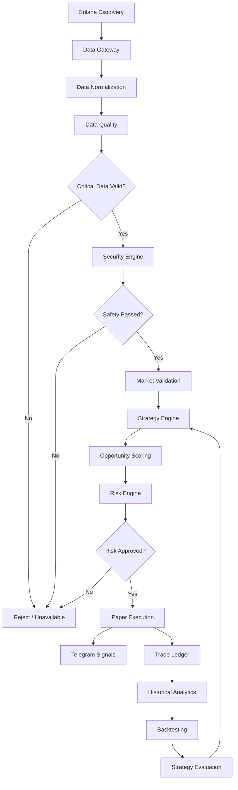

# BANGZEN PRIME 2026
## Master Blueprint — Hybrid Intelligence Solana Trading System

**Project:** BANGZEN PRIME  
**Version:** 1.0 — Blueprint  
**Architecture:** Hybrid FAST PATH + SLOW PATH  
**Initial Operating Mode:** Watch-only / Paper Trading  
**Evaluation Period:** 60 Days  
**Primary Objective:** Consistent Net Profit After All Costs  
**Execution Status:** LIVE TRADING LOCKED

---

# 1. PROJECT VISION

BANGZEN PRIME bukan sekadar token scanner atau Telegram signal bot.

BANGZEN PRIME dirancang sebagai sistem analisis dan pengambilan keputusan untuk ekosistem Solana yang mampu:

1. Menemukan peluang token secara real-time.
2. Mengumpulkan dan memvalidasi data on-chain serta market.
3. Mendeteksi token berisiko sebelum masuk ke tahap strategi.
4. Menjalankan beberapa strategi secara terpisah.
5. Menghitung risiko dan estimasi biaya secara konsisten.
6. Menghasilkan sinyal yang memiliki alasan dan bukti.
7. Melakukan simulasi entry, TP, SL, dan exit.
8. Mengukur profit bersih, bukan sekadar keuntungan harga.
9. Mempelajari hasil strategi secara berkelanjutan.
10. Mengembangkan strategi berdasarkan bukti historis.

## 1.1 Primary Objective

Tujuan utama:

**Meningkatkan profit bersih sistem secara konsisten dengan tetap mengutamakan survival, keamanan, dan pengendalian risiko.**

Urutan prioritas:

1. Survival.
2. Data integrity.
3. Security.
4. Risk control.
5. Opportunity discovery.
6. Strategy quality.
7. Net profitability.
8. Continuous learning.
9. Optimization.

Sistem tidak boleh mengorbankan keselamatan demi memperbanyak sinyal.

## 1.2 Operating Principles

- Fail closed when critical safety data is unavailable.
- No fabricated market data.
- No fabricated test results.
- No hidden execution.
- No automatic changes to protected risk parameters.
- No private-key signing code during initial development.
- No live trading without explicit authorization.
- Every signal must have reason codes.
- Every simulated trade must be auditable.
- Every strategy change must be tested.
- Every important change must be recorded in Change Ledger.

---

# 2. INITIAL LAUNCH CONFIGURATION

| Component | Initial Configuration |
|---|---|
| Operating mode | Hybrid |
| Fast path | Real-time discovery and analysis |
| Slow path | Historical analytics and learning |
| Trading mode | Watch-only / Paper |
| Evaluation | 60 days |
| Strategy deployment | Experimental, isolated |
| Risk engine | Deterministic |
| Telegram | Signal-only |
| Wallet integration | Disabled |
| Transaction signing | Prohibited |
| Automatic strategy mutation | Disabled |
| Continuous evaluation | Enabled |

Evaluasi 60 hari bukan berarti sistem harus menunggu 60 hari untuk memperbaiki kesalahan.

Evaluasi dilakukan secara berkelanjutan sejak hari pertama.

---

# 3. SYSTEM ARCHITECTURE

BANGZEN PRIME menggunakan dua jalur utama.

## 3.1 FAST PATH

FAST PATH bertanggung jawab terhadap proses real-time.

Tugas:

1. Token discovery.
2. Market data ingestion.
3. On-chain data ingestion.
4. Data normalization.
5. Data quality validation.
6. Token security checks.
7. Liquidity validation.
8. Strategy evaluation.
9. Opportunity scoring.
10. Risk Engine approval.
11. Paper trade simulation.
12. Telegram signal generation.

FAST PATH harus:

- Cepat.
- Deterministik pada proses kritis.
- Tidak menunggu AI analysis.
- Tidak menunggu backtesting.
- Tidak mengakses private key.
- Tidak mengabaikan Risk Engine.

## 3.2 SLOW PATH

SLOW PATH bertanggung jawab terhadap analisis historis dan evaluasi.

Tugas:

1. Historical market analysis.
2. Signal outcome tracking.
3. Paper trade performance.
4. Strategy backtesting.
5. Walk-forward validation.
6. Out-of-sample testing.
7. Cost analysis.
8. Strategy comparison.
9. Error analysis.
10. Improvement recommendations.

SLOW PATH tidak boleh mengubah FAST PATH secara langsung.

Perubahan strategi harus melalui:

Proposal → Review → Test → Approval → Versioned Deployment.

## 3.3 Architecture Diagram



---

# 4. DATA PROVIDERS AND API REQUIREMENTS

Provider dipilih berdasarkan fungsi, kualitas data, latency, biaya, dan batas penggunaan.

Jangan mengaktifkan semua provider sekaligus tanpa mengukur kebutuhan.

## 4.1 Core Providers

### Helius

Purpose:
- Solana RPC.
- Transaction data.
- Account and wallet activity.
- Token and program information.
- On-chain monitoring.

Environment variable:

```env
HELIUS_API_KEY=
```

### DexScreener

Purpose:
- Token discovery.
- Pair information.
- Price.
- Volume.
- Liquidity.
- Market activity.

Environment variable:

```env
DEXSCREENER_API_KEY=
```

Jika endpoint yang digunakan bersifat publik dan tidak memerlukan key, jangan membuat credential palsu atau tidak diperlukan.

### Birdeye

Purpose:
- Historical OHLCV.
- Price history.
- Volume analytics.
- Market data.
- Token metrics.

Environment variable:

```env
BIRDEYE_API_KEY=
```

### RugCheck

Purpose:
- Token risk intelligence.
- Authority-related checks.
- Holder-related risk indicators.
- Risk report.

Environment variable:

```env
RUGCHECK_API_KEY=
```

Gunakan hanya jika endpoint yang dipakai memang mensyaratkan autentikasi.

### Jupiter

Purpose:
- Quote reference.
- Expected execution price.
- Price impact.
- Route comparison.
- Paper execution cost estimation.

Environment variable:

```env
JUPITER_API_KEY=
```

Kebutuhan autentikasi mengikuti endpoint dan kebijakan provider.

Pada tahap awal Jupiter hanya digunakan untuk quote dan simulasi.

Tidak melakukan swap sungguhan.

## 4.2 Telegram

Required:

```env
TELEGRAM_BOT_TOKEN=
TELEGRAM_CHAT_ID=
```

Purpose:
- Signal delivery.
- Risk warnings.
- Paper trade updates.
- Daily performance reports.
- System health notifications.

Telegram hanya menerima informasi yang telah melewati validasi.

## 4.3 Optional Infrastructure

| Component | Purpose | Priority |
|---|---|---|
| PostgreSQL | Historical database | High |
| Redis | Cache and queue | Medium |
| Secondary RPC | Provider redundancy | Medium |
| Metrics dashboard | Performance monitoring | Medium |
| Object storage | Historical archives | Low initially |

## 4.4 API Security Rules

1. Semua secret disimpan di environment atau secret manager.
2. Tidak ada API key di source code.
3. Tidak ada API key di GitHub.
4. Tidak ada secret di Telegram.
5. Provider adapter hanya membaca credential yang diperlukan.
6. AI Commander tidak boleh membaca secret secara langsung.
7. Setiap provider memiliki timeout.
8. Setiap provider memiliki rate-limit handling.
9. Setiap provider memiliki error handling.
10. Data provider tidak boleh dianggap valid hanya karena request berhasil.

---

# 5. DATA GATEWAY

Data Gateway merupakan satu-satunya pintu utama untuk komunikasi provider eksternal.

Tanggung jawab:

- Provider selection.
- API request.
- Authentication.
- Timeout.
- Retry policy.
- Rate limiting.
- Cache.
- Data normalization.
- Provenance tracking.
- Provider health.
- Fallback handling.

Strategy Engine tidak boleh melakukan request API secara langsung.

Contoh:

```text
Strategy Engine
      |
      v
Data Gateway
      |
      +---- Helius
      |
      +---- DexScreener
      |
      +---- Birdeye
      |
      +---- RugCheck
      |
      +---- Jupiter
```

## 5.1 Provider Failure Policy

Jika provider utama gagal:

1. Coba fallback yang telah disetujui.
2. Periksa kesegaran data.
3. Periksa konsistensi data.
4. Tandai sumber data.
5. Jika critical data tetap tidak tersedia, hentikan keputusan terkait.

Jangan mengisi data yang hilang dengan angka perkiraan lalu menganggapnya valid.

---

# 6. DATA SCHEMA

Setiap token harus memiliki identitas dan snapshot data yang konsisten.

## 6.1 Token Identity

```json
{
  "chain": "solana",
  "mint_address": "",
  "symbol": "",
  "name": "",
  "first_seen_at": null,
  "pool_address": "",
  "discovery_source": "",
  "schema_version": "1.0"
}
```

## 6.2 Market Snapshot

```json
{
  "mint_address": "",
  "timestamp": "",
  "price_usd": null,
  "market_cap_usd": null,
  "liquidity_usd": null,
  "volume_5m": null,
  "volume_15m": null,
  "volume_1h": null,
  "buys_5m": null,
  "sells_5m": null,
  "unique_buyers_5m": null,
  "unique_sellers_5m": null,
  "data_sources": [],
  "data_quality": "UNAVAILABLE"
}
```

## 6.3 Security Snapshot

```json
{
  "mint_address": "",
  "timestamp": "",
  "mint_authority": null,
  "freeze_authority": null,
  "holder_concentration": null,
  "top_holder_percentage": null,
  "liquidity_status": "UNKNOWN",
  "security_flags": [],
  "provider_sources": [],
  "status": "UNAVAILABLE"
}
```

## 6.4 Strategy Signal

```json
{
  "signal_id": "",
  "mint_address": "",
  "strategy_name": "",
  "strategy_version": "",
  "timestamp": "",
  "score": null,
  "score_type": "RANKING_SCORE",
  "reason_codes": [],
  "risk_status": "PENDING",
  "data_snapshot_id": "",
  "mode": "PAPER"
}
```

## 6.5 Paper Trade

```json
{
  "trade_id": "",
  "signal_id": "",
  "mint_address": "",
  "entry_timestamp": null,
  "entry_price": null,
  "exit_timestamp": null,
  "exit_price": null,
  "position_size": null,
  "gross_pnl": null,
  "trading_fees": null,
  "network_fees": null,
  "entry_slippage": null,
  "exit_slippage": null,
  "other_costs": null,
  "net_pnl": null,
  "exit_reason": null,
  "status": "PAPER"
}
```

Semua timestamp harus menggunakan format standar UTC.

Nilai yang tidak tersedia harus direpresentasikan sebagai null atau status UNAVAILABLE, bukan angka nol yang menyesatkan.

---

# 7. TOKEN DISCOVERY ENGINE

Tujuan:

Menemukan token potensial sebelum peluangnya terlambat.

Discovery sources:

1. Newly created pools.
2. Newly active tokens.
3. Volume expansion.
4. Unique buyer growth.
5. Wallet activity.
6. Community takeover candidates.
7. Previously monitored tokens with renewed activity.

Discovery bukan keputusan entry.

Semua kandidat harus melewati validasi data dan keamanan.

## 7.1 Discovery Requirements

- Deduplicate mint addresses.
- Track first seen timestamp.
- Track pool creation.
- Detect repeated events.
- Avoid duplicate Telegram signals.
- Maintain provider provenance.
- Enforce rate limits.
- Reject malformed addresses.
- Handle provider outages.

---

# 8. MARKET VALIDATION ENGINE

Market Validation mengukur apakah aktivitas token benar-benar didukung data yang cukup.

Data utama:

- Price movement.
- Volume.
- Liquidity.
- Buy/sell transaction counts.
- Unique buyers.
- Unique sellers.
- Pool age.
- Holder concentration.
- Price impact.
- Market depth when available.

Volume tinggi saja bukan bukti bahwa token berkualitas.

Sistem harus mengidentifikasi:

- Wash trading indicators.
- Repeated wallet activity.
- Abnormal transaction patterns.
- Thin liquidity.
- Sudden liquidity removal.
- Price manipulation indicators.

---

# 9. STRATEGY ENGINE

Setiap strategi harus terisolasi.

Strategi tidak boleh mengubah Risk Engine.

## 9.1 RSI + Volume Strategy

Strategi kombinasi yang telah ditentukan sebagai kandidat awal:

| Indicator | Candidate Condition |
|---|---:|
| RSI 1h | 40–65 |
| RSI 5m | 35–50 |
| Volume spike | > 1.5x |
| Buy ratio | > 1.0 |

Interpretasi:

- Kondisi lengkap menghasilkan kandidat Grade A untuk paper evaluation.
- Kondisi tidak lengkap menghasilkan WAIT atau SKIP.
- RSI terlalu tinggi meningkatkan risiko FOMO.
- Volume tanpa pertumbuhan unique buyers harus dicurigai.
- Buy ratio tidak boleh digunakan tanpa data transaksi yang valid.

Kondisi yang harus dihindari:

- RSI 5m > 75.
- RSI 1h < 30 dengan dominasi seller.
- Liquidity terlalu rendah.
- Data volume tidak konsisten.
- Market snapshot terlalu lama.
- Harga bergerak akibat aktivitas wallet yang tidak representatif.

Parameter ini merupakan parameter eksperimen paper/watch-only. Perubahan harus melalui persetujuan dan pengujian.

## 9.2 CTO Engine — Community Takeover

CTO tidak boleh hanya mengidentifikasi developer yang meninggalkan token.

Tujuannya adalah mengukur apakah komunitas menunjukkan aktivitas yang nyata dan berkelanjutan.

Data yang diperlukan:

- Developer wallet activity.
- Holder distribution.
- Unique buyers.
- Unique sellers.
- Wallet diversity.
- Transaction consistency.
- Liquidity trend.
- Volume trend.
- Community activity where verifiable.
- Token age.

CTO Score harus disusun dari komponen yang memiliki bukti.

Contoh komponen:

```text
Community Activity
Wallet Diversity
Buyer Growth
Liquidity Stability
Volume Consistency
Developer Activity
Holder Concentration Risk
Market Quality
```

Skor bukan probabilitas keberhasilan.

Setiap skor harus disertai reason codes dan sumber data.

## 9.3 Multi-Strategy Architecture

Strategi yang dapat dikembangkan:

1. RSI + Volume.
2. CTO.
3. Momentum.
4. Volume Expansion.
5. Liquidity Recovery.
6. Wallet Activity.
7. Mean Reversion.

Strategi baru tidak boleh otomatis aktif di production.

Setiap strategi harus melewati:

Discovery → Implementation → Unit Tests → Backtest → Out-of-Sample → Paper Evaluation → Approval.

---

# 10. SCORING SYSTEM

Scoring digunakan untuk mengurutkan kandidat.

Scoring bukan probabilitas profit.

Contoh kategori:

| Category | Purpose |
|---|---|
| Market Quality | Kualitas kondisi pasar |
| Momentum | Kekuatan pergerakan |
| Volume Quality | Kualitas aktivitas volume |
| Buyer Quality | Pertumbuhan pembeli unik |
| Liquidity Quality | Kemampuan keluar |
| Security Risk | Risiko token |
| Data Quality | Kelengkapan dan kesegaran data |
| Strategy Alignment | Kesesuaian strategi |

Hard safety gates harus berjalan sebelum scoring digunakan untuk keputusan akhir.

Tidak ada skor tinggi yang dapat menghapus veto keamanan.

---

# 11. RISK ENGINE

Risk Engine merupakan otoritas deterministik terakhir.

Tanggung jawab:

- Position sizing policy.
- Maximum exposure.
- Liquidity constraints.
- Slippage limits.
- Data freshness.
- Maximum drawdown rules.
- Stop-loss policy.
- Emergency stop.
- Trade eligibility.
- Risk veto.

Risk Engine harus terisolasi dari AI Commander dan Strategy Engine.

## 11.1 Fail-Closed Rules

Reject atau block jika:

- Critical data unavailable.
- Token security checks gagal.
- Liquidity tidak memenuhi syarat.
- Price data stale.
- Slippage estimation unavailable.
- Risk limits tidak tersedia.
- HALT.flag aktif.
- Paper execution state tidak konsisten.

## 11.2 Emergency Stop

HALT.flag harus menghentikan proses yang membutuhkan keputusan trading.

Tidak boleh ada modul strategi yang dapat mengabaikan emergency stop.

## 11.3 Risk Parameter Protection

Perubahan terhadap:

- Maximum drawdown.
- Position size.
- Stop-loss.
- Exposure.
- Slippage limit.
- Liquidity threshold.
- Risk score thresholds.

Harus melalui persetujuan eksplisit, tes regresi, dan Change Ledger.

---

# 12. PAPER EXECUTION ENGINE

Paper execution harus realistis.

Tidak cukup menggunakan harga sinyal sebagai harga entry dan harga terakhir sebagai harga exit.

Komponen:

1. Entry price estimation.
2. Exit price estimation.
3. Entry slippage.
4. Exit slippage.
5. Trading fee.
6. Network fee.
7. Price impact.
8. Liquidity constraints.
9. Partial fill simulation.
10. Failed exit simulation.
11. TP/SL monitoring.
12. Timeout exit.
13. Trade ledger.

## 12.1 Net PnL

```text
Gross PnL = Exit Value - Entry Value

Net PnL =
    Gross PnL
    - Entry Trading Fee
    - Exit Trading Fee
    - Network Fees
    - Entry Slippage
    - Exit Slippage
    - Other Costs
```

Semua biaya harus dihitung secara konsisten.

Jangan mencampur persentase dan nilai nominal tanpa konversi yang benar.

## 12.2 TP/SL Path Testing

Tes wajib:

- Entry → TP.
- Entry → SL.
- Entry → timeout.
- Entry → partial exit.
- Entry → failed exit.
- TP and SL touched in same candle.
- Liquidity collapses before exit.
- Price data missing.
- Provider interruption.
- Duplicate execution events.

Jika urutan TP dan SL dalam candle yang sama tidak diketahui, gunakan asumsi konservatif atau data resolusi lebih tinggi.

---

# 13. TELEGRAM SIGNAL ENGINE

Telegram berfungsi sebagai sistem pemberitahuan.

Format sinyal:

```text
BANGZEN PRIME

TOKEN: [SYMBOL]
CHAIN: Solana
MINT: [ADDRESS]

STRATEGY: [STRATEGY]
STRATEGY VERSION: [VERSION]

MARKET:
Price:
Liquidity:
Volume:
RSI 5m:
RSI 1h:
Buy Ratio:
Unique Buyers:

SECURITY:
Status:
Risk Flags:

SIGNAL:
Score:
Grade:
Reason Codes:

PAPER ENTRY:
Estimated Entry:
Invalidation:
Stop Loss:
Take Profit:

COST ESTIMATION:
Entry Fee:
Exit Fee:
Slippage:
Price Impact:

MODE: PAPER / WATCH ONLY

Timestamp:
Data Sources:
```

Telegram tidak boleh mengirim sinyal sebagai instruksi membeli sungguhan.

Setiap sinyal harus dapat ditelusuri ke data snapshot dan strategy version.

---

# 14. AI COMMANDER AND CONTINUOUS LEARNING

AI Commander bertugas membantu analisis, bukan mengambil alih otoritas keamanan.

Tugas:

- Summarize historical outcomes.
- Compare strategy performance.
- Identify recurring failures.
- Detect data-quality problems.
- Recommend experiments.
- Generate research reports.
- Explain strategy performance.

AI Commander tidak boleh:

- Mengakses private key.
- Menandatangani transaksi.
- Mengubah Risk Engine.
- Mengubah protected thresholds.
- Mengabaikan HALT.flag.
- Mengaktifkan live trading.
- Menganggap output model sebagai fakta tanpa validasi.

## 14.1 Learning Cycle

```text
Collect
  |
  v
Analyze
  |
  v
Find Failure Patterns
  |
  v
Generate Improvement Proposal
  |
  v
Review
  |
  v
Test
  |
  v
Backtest
  |
  v
Out-of-Sample Validation
  |
  v
Paper Evaluation
  |
  v
Approval
  |
  v
Versioned Deployment
```

Continuous learning berarti rekomendasi terus diperbarui.

Bukan berarti sistem bebas mengubah kode atau parameter risiko sendiri.

---

# 15. TARGET FOLDER STRUCTURE

Struktur berikut adalah target arsitektur konseptual.

Sebelum implementasi, bandingkan dengan repository aktual. Pertahankan modul yang sudah menjalankan fungsi sama. Jangan membuat duplikasi.

```text
BANGZEN_PRIME/
│
├── AI_RULES.yaml
├── AGENTS.md
├── RULES.md
├── SECURITY.md
├── README.md
├── pyproject.toml
├── requirements.txt
├── .env.example
├── .gitignore
│
├── .github/
│   └── workflows/
│       └── ci.yml
│
├── bangzen_prime/
│   ├── main.py
│   │
│   ├── core/
│   │   ├── orchestrator.py
│   │   ├── event_bus.py
│   │   ├── config.py
│   │   └── state.py
│   │
│   ├── data/
│   │   ├── gateway.py
│   │   ├── normalization.py
│   │   ├── quality.py
│   │   ├── provenance.py
│   │   ├── cache.py
│   │   └── providers/
│   │       ├── helius.py
│   │       ├── dexscreener.py
│   │       ├── birdeye.py
│   │       ├── rugcheck.py
│   │       └── jupiter.py
│   │
│   ├── discovery/
│   │   ├── scanner.py
│   │   ├── token_registry.py
│   │   └── deduplication.py
│   │
│   ├── security/
│   │   ├── token_audit.py
│   │   ├── holder_analysis.py
│   │   └── security_gate.py
│   │
│   ├── market/
│   │   ├── market_analyzer.py
│   │   ├── liquidity.py
│   │   ├── volume.py
│   │   ├── transactions.py
│   │   └── indicators.py
│   │
│   ├── strategies/
│   │   ├── base.py
│   │   ├── rsi_volume.py
│   │   ├── cto.py
│   │   ├── momentum.py
│   │   └── registry.py
│   │
│   ├── scoring/
│   │   ├── opportunity.py
│   │   └── reason_codes.py
│   │
│   ├── risk/
│   │   ├── engine.py
│   │   ├── limits.py
│   │   ├── position_sizing.py
│   │   ├── slippage.py
│   │   └── emergency_stop.py
│   │
│   ├── execution/
│   │   ├── paper_engine.py
│   │   ├── fill_simulator.py
│   │   ├── tp_sl.py
│   │   └── cost_model.py
│   │
│   ├── notifications/
│   │   └── telegram.py
│   │
│   ├── analytics/
│   │   ├── performance.py
│   │   ├── trade_analysis.py
│   │   ├── strategy_comparison.py
│   │   └── reports.py
│   │
│   ├── research/
│   │   ├── backtest.py
│   │   ├── walk_forward.py
│   │   ├── out_of_sample.py
│   │   └── improvement_proposals.py
│   │
│   └── storage/
│       ├── database.py
│       ├── repositories.py
│       └── migrations/
│
├── configs/
│   ├── providers.yaml
│   ├── strategies.yaml
│   └── paper.yaml
│
├── tests/
│   ├── unit/
│   ├── integration/
│   ├── security/
│   ├── regression/
│   └── fixtures/
│
├── scripts/
│   ├── run_tests.py
│   └── run_paper.py
│
├── tools/
│   └── ci.py
│
├── native/
│   └── rust/
│
├── docs/
│   ├── ARCHITECTURE.md
│   ├── DATA_SCHEMA.md
│   ├── RISK_POLICY.md
│   ├── API_PROVIDERS.md
│   ├── PAPER_TRADING.md
│   └── CHANGE_LEDGER.md
│
└── reports/
    ├── daily/
    └── evaluation/
```

---

# 16. WHAT TO KEEP, FIX, REPLACE, AND ADD

Jangan melakukan rewrite seluruh repository tanpa audit.

Setiap modul harus diperiksa terlebih dahulu.

## KEEP

Pertahankan apabila sudah benar:

- Existing CI infrastructure.
- Working Rust components.
- Existing risk checks.
- Existing provider integrations.
- Existing tested indicators.
- Existing database schema where compatible.
- Existing Telegram sender.
- Existing security rules.

## FIX

Perbaiki jika ditemukan masalah:

- Data normalization.
- Missing-data handling.
- Provider timeout.
- Retry and rate-limit handling.
- Duplicate signals.
- Incorrect fee calculations.
- Net PnL calculations.
- TP/SL path handling.
- Inconsistent timestamps.
- Stale market snapshots.
- Incorrect buyer/seller metrics.
- Risk Engine bypass possibilities.
- CI reporting and failure handling.

## REPLACE

Ganti hanya jika modul lama terbukti tidak aman atau tidak dapat diperbaiki secara wajar.

Contoh:

- Duplicate data gateways.
- Conflicting market schemas.
- Unreliable cost model.
- Strategy code coupled to provider requests.
- Non-deterministic risk logic.
- Execution logic that bypasses risk approval.

Replacement harus memiliki compatibility plan dan regression tests.

## ADD

Tambahkan jika memang belum tersedia:

- Historical analytics.
- Paper execution ledger.
- Provider provenance.
- Data quality engine.
- Strategy registry.
- CTO community analysis.
- Walk-forward testing.
- Out-of-sample validation.
- Performance reports.
- Continuous improvement proposals.

---

# 17. DATABASE AND STORAGE STRATEGY

Tahap awal dapat menggunakan database lokal untuk paper trading.

Target jangka menengah:

PostgreSQL.

Tabel utama:

| Table | Purpose |
|---|---|
| tokens | Token identity |
| pools | Pool information |
| market_snapshots | Market data |
| onchain_events | On-chain activity |
| security_snapshots | Security analysis |
| signals | Generated signals |
| paper_trades | Simulated trades |
| trade_events | Entry/exit lifecycle |
| strategy_versions | Strategy history |
| provider_health | Provider status |
| evaluation_runs | Backtest and evaluation |
| change_records | Auditable changes |

Data historis tidak boleh diubah tanpa jejak.

Setiap strategi dan sinyal harus memiliki version identifier.

---

# 18. PERFORMANCE METRICS

Jangan menilai sistem hanya berdasarkan jumlah sinyal.

## 18.1 Discovery Metrics

- Tokens discovered.
- Valid tokens.
- Rejected tokens.
- Duplicate rate.
- Discovery latency.
- Data completeness.

## 18.2 Strategy Metrics

- Signal count.
- Precision of defined setup conditions.
- Win rate.
- Average win.
- Average loss.
- Expectancy.
- Profit factor.
- Maximum drawdown.
- Strategy stability.

## 18.3 Financial Metrics

- Gross PnL.
- Net PnL.
- Trading fees.
- Network fees.
- Slippage.
- Price impact.
- Cost per trade.
- Net expectancy.

Rumus:

```text
Net PnL =
Gross PnL
- Trading Fees
- Network Fees
- Slippage
- Other Costs
```

Expectancy:

```text
Expectancy =
(Win Rate x Average Win)
-
(Loss Rate x Average Loss)
-
Average Trading Costs
```

## 18.4 System Metrics

- API availability.
- API latency.
- Provider error rate.
- Data staleness.
- Queue delay.
- Signal processing latency.
- Crash frequency.
- Restart recovery.
- Memory usage.
- CPU usage.

---

# 19. 60-DAY IMPLEMENTATION ROADMAP

Evaluasi berlangsung terus-menerus.

## Phase 0 — Repository and CI Integrity

Objective:
Mengetahui kondisi proyek sebenarnya.

Tasks:

- Audit seluruh struktur repository.
- Audit AI_RULES.yaml.
- Audit AGENTS.md.
- Audit RULES.md.
- Audit SECURITY.md.
- Audit tools/ci.py.
- Audit GitHub workflow.
- Diagnose all CI failures.
- Verify current tests.
- Record baseline commit.
- Create Change Ledger.

Acceptance:

- No fabricated test results.
- CI failures identified.
- Existing tests preserved.
- No weakened security checks.
- No trading execution enabled.

## Phase 1 — Data Foundation

Objective:
Membangun sumber data yang konsisten.

Tasks:

- Provider adapters.
- Data Gateway.
- Normalization.
- Provenance.
- Data quality.
- Cache.
- Provider health.
- Rate limits.
- Historical snapshots.

Acceptance:

- Data source recorded.
- Missing data handled safely.
- Stale data rejected.
- Provider failures handled.
- Duplicate events controlled.

## Phase 2 — Discovery and Security

Objective:
Menemukan kandidat dan menghindari token berbahaya.

Tasks:

- Token discovery.
- Pool discovery.
- Token registry.
- Holder analysis.
- Authority checks.
- Liquidity validation.
- Security gates.
- Risk reason codes.

Acceptance:

- No token passes without mandatory safety checks.
- Unavailable data never becomes PASS.
- Every decision is auditable.

## Phase 3 — Strategy Engine

Objective:
Menjalankan strategi secara independen.

Tasks:

- RSI + Volume.
- CTO.
- Strategy registry.
- Opportunity scoring.
- Reason codes.
- Signal snapshots.
- Strategy versioning.

Acceptance:

- Strategy isolation.
- Deterministic tests.
- No direct provider calls from strategy code.
- No Risk Engine bypass.

## Phase 4 — Paper Execution

Objective:
Mengukur hasil secara realistis.

Tasks:

- Entry simulation.
- Exit simulation.
- Fee model.
- Slippage model.
- Price impact.
- TP/SL.
- Timeout.
- Partial fill.
- Trade ledger.

Acceptance:

- Complete trade lifecycle.
- Net PnL calculated consistently.
- TP/SL tests pass.
- Conservative handling of ambiguous candles.
- No real transaction signing.

## Phase 5 — Analytics and Learning

Objective:
Mengetahui strategi yang benar-benar bekerja.

Tasks:

- Historical analysis.
- Daily reports.
- Backtesting.
- Walk-forward validation.
- Out-of-sample testing.
- Strategy comparison.
- Failure analysis.
- Improvement proposals.

Acceptance:

- No look-ahead bias.
- Costs included.
- Results reproducible.
- Strategy changes require approval.

## Phase 6 — 60-Day Evaluation

Objective:
Menilai apakah sistem layak dikembangkan lebih lanjut.

Tasks:

- Compare strategies.
- Measure net expectancy.
- Measure drawdown.
- Evaluate data quality.
- Evaluate reliability.
- Analyze failed signals.
- Review risk controls.
- Prepare final report.

Acceptance:

- Complete evidence.
- Reproducible performance.
- No unresolved critical security issues.
- No unexplained losses in paper lifecycle.
- Live trading remains locked until separate authorization.

---

# 20. CI/CD AND ENGINEERING QUALITY GATE

BANGZEN PRIME menggunakan aturan engineering yang telah ditentukan.

Project constitution:

- AI_RULES.yaml
- AGENTS.md
- RULES.md
- SECURITY.md
- tools/ci.py

Required quality checks according to the project's configured CI:

- Black.
- Ruff.
- Mypy.
- Bandit.
- Semgrep.
- Safety.
- Pip-Audit.
- Pytest.
- Cargo Audit.
- Rust tests.
- Compile checks.

The exact command inventory must be verified against the repository's actual configuration.

## 20.1 CI Rules

1. Never weaken tests just to obtain green CI.
2. Never hide failed checks.
3. Never convert unavailable security checks into PASS.
4. Never fabricate test evidence.
5. Preserve Rust and Cargo Audit checks.
6. Test changes locally before pushing.
7. Record all changes.
8. Keep pull requests focused.
9. Do not merge without repository owner approval.
10. Do not call work DONE before the required full CI is green.

## 20.2 Required Change Ledger

Every meaningful change records:

- Objective.
- Non-goals.
- Base branch and SHA.
- Head branch and SHA.
- Changed files.
- Compatibility.
- Security impact.
- Tests executed.
- Test results.
- Checks not executed.
- Known limitations.
- Rollback instructions.

---

# 21. SECURITY AND LIVE TRADING LOCK

During initial development:

- Watch-only.
- Paper trading only.
- No wallet private key.
- No transaction signing.
- No automatic buy.
- No automatic sell.
- No execution bypass.
- No autonomous modification of protected risk limits.

Live trading is a separate future project stage.

It requires:

1. Explicit authorization.
2. Full security audit.
3. Complete execution lifecycle tests.
4. Transaction cost validation.
5. Risk Engine validation.
6. Emergency stop validation.
7. Operational readiness.
8. Independent approval.

A green CI alone does not authorize live trading.

---

# 22. FINAL ACCEPTANCE CRITERIA

BANGZEN PRIME is ready for the next development stage only when:

## Data

- Data providers are validated.
- Data freshness is enforced.
- Data provenance is recorded.
- Missing critical data fails closed.
- Provider outages are handled.

## Security

- Token safety checks are tested.
- Secrets are protected.
- Risk Engine cannot be bypassed.
- Emergency stop works.
- No prohibited signing functionality exists.

## Strategies

- Strategies are isolated.
- Signals are reproducible.
- Reason codes are available.
- Backtests are reproducible.
- Out-of-sample evaluation is completed.

## Paper Trading

- Entry and exit lifecycle is complete.
- Costs are included.
- TP/SL logic is tested.
- Net PnL is auditable.
- Drawdown is measured.

## Engineering

- Tests pass.
- CI is fully green.
- Security checks are recorded.
- Change Ledger is updated.
- Documentation matches actual implementation.

## Financial Evaluation

- Net expectancy is measured.
- Performance survives cost assumptions.
- Drawdown is within approved limits.
- Results are not based on a small or biased sample.
- Strategy performance is stable enough for further evaluation.

Passing these criteria does not automatically enable live trading.

---

# 23. IMPLEMENTATION ORDER

Do not implement everything at once.

Recommended order:

1. Repository audit.
2. CI repair.
3. Architecture mapping.
4. Data Gateway.
5. Data schema.
6. Data quality.
7. Security gates.
8. Market validation.
9. Strategy registry.
10. RSI + Volume strategy.
11. CTO strategy.
12. Scoring.
13. Risk Engine integration.
14. Paper execution.
15. Telegram reporting.
16. Historical analytics.
17. Backtesting.
18. Continuous improvement.
19. 60-day evaluation.

Every stage must have acceptance criteria before the next stage begins.

---

# 24. FINAL ENGINEERING DIRECTIVE

BANGZEN PRIME must be developed as an evidence-driven system.

Do not rewrite working modules without justification.

Do not add unnecessary folders.

Do not create duplicate provider integrations.

Do not weaken existing tests.

Do not allow AI to override deterministic safety controls.

Do not optimize for signal quantity.

Optimize for reliable data, controlled risk, realistic paper execution, and measurable net profitability.

The FAST PATH must remain responsive.

The SLOW PATH must improve the system through evidence.

The Risk Engine must retain final veto authority.

Live execution remains locked.

**The objective is not to build the most complicated bot. The objective is to build a reliable system that can prove, with reproducible evidence, whether its decisions produce consistent net profit after all costs.**
